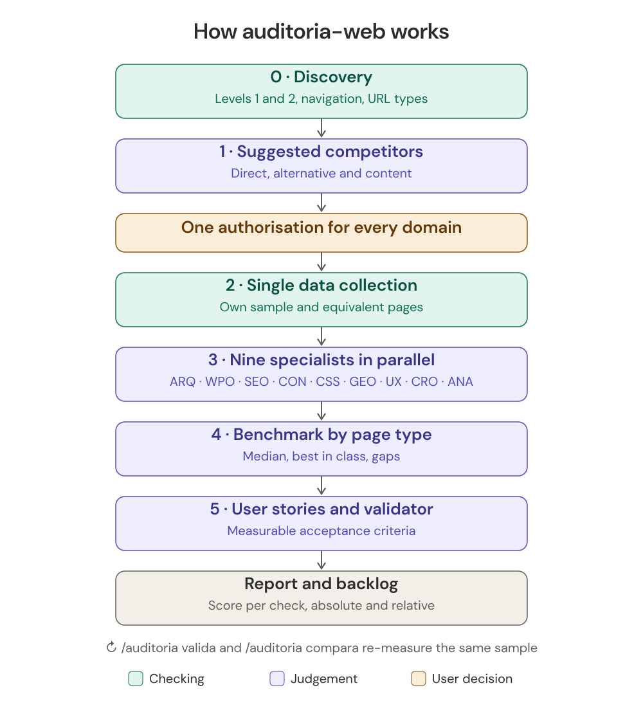
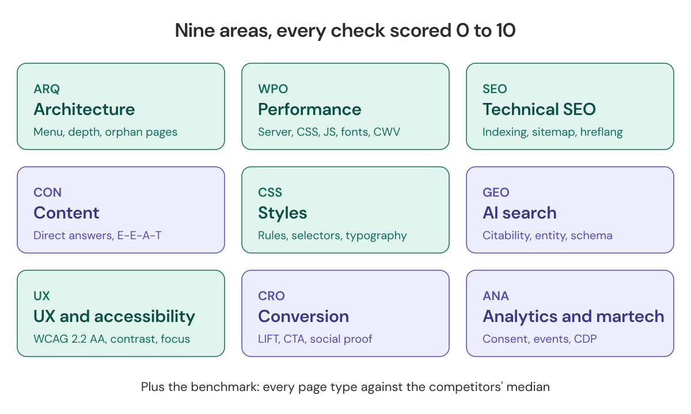
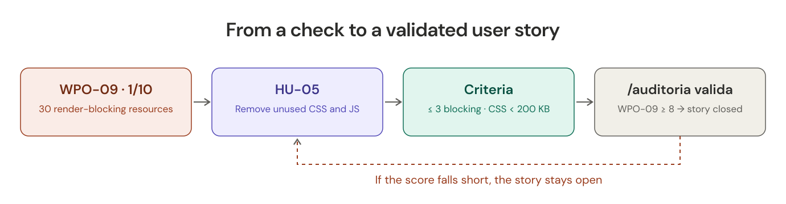

# auditoria-web

**A complete website audit with subagents for Claude**: discovery, architecture, performance (WPO), technical SEO, content, styles, GEO, UX and accessibility, CRO and analytics. It compares every page type with competitors and turns findings into **user stories with acceptance criteria** that are validated by measuring again.

[Versión en español](README.md) · Author: [Javier Ortiz](https://makethejump.org) · MIT licence



## What makes it different

- **It understands the site before measuring it.** It crawls levels 1 and 2, extracts the navigation, detects the business type, classifies URLs and picks a representative sample. It never audits only the home page.
- **Everything gets a score, including what is fine.** Each check has an ID, a measured value, a target and a 0–10 score. No measured value, no score.
- **Benchmark by page type.** It suggests direct, alternative and content competitors, asks for **a single authorisation** to open them all, and compares each page type with the median and the best in class.
- **It ends in a backlog, not a PDF.** Every low score becomes a user story with measurable criteria, ready for Jira, Linear or GitHub Issues.
- **Safe by design.** No hooks, no telemetry, no stored keys, and it never changes the site: read-only.





## Install

### Claude Code (recommended: real measurements with Playwright)

```bash
/plugin marketplace add javierortizsaiz-dot/makethejump
/plugin install auditoria-web@makethejump
```

So the collector can measure performance, accessibility and CSS in a real browser:

```bash
npm install
npx playwright install chromium
```

### claude.ai

Download [`dist/auditoria-web-skill.zip`](dist/auditoria-web-skill.zip) and upload it under **Settings → Capabilities → Skills**. On claude.ai it runs in basic mode, using the session's subagents and measuring with the browser or fetch.

## Usage

| Command | What it does |
| --- | --- |
| `/auditoria <url>` | Full audit: discovery, competitors, 9 areas, benchmark and stories |
| `/auditoria <area> <url>` | One area: descubrimiento, arquitectura, wpo, seo, contenido, estilos, geo, ux, cro, analitica or benchmark |
| `/auditoria baseline <url>` | Saves every check's score for later comparison |
| `/auditoria compara <url>` | Re-measures the same sample and shows what changed |
| `/auditoria valida HU-05 <url>` | Re-measures only one story's checks and says whether its criteria pass |

The skill writes its reports in Spanish by default; ask it to write in English and it will.

## How it is built

| Phase | Subagent | Model | Tools |
| --- | --- | --- | --- |
| 0 · Discovery | `descubridor` | Sonnet | WebFetch, Bash, Read, Write |
| 1 · Competitors | `analista-mercado` | Opus | WebSearch, WebFetch |
| 2 · Collection | `recolector` (uses `scripts/recoger.mjs`) | Sonnet | Bash, WebFetch |
| 3 · Specialists | `arquitectura`, `wpo`, `seo-tecnico`, `estilos`, `ux-accesibilidad` | Sonnet | Read-only on collected data |
| 3 · Specialists | `contenido`, `geo`, `cro`, `analitica-martech` | Opus | Read-only on collected data |
| 4 · Benchmark | `benchmark` | Opus | Read-only |
| 5 · Stories | `product-owner` | Opus | Read and write the report |
| 5 · Validation | `validador` | Sonnet | Read-only |

Data is collected **once** and specialists work on it without repeating requests. Higher-judgement models (Opus) are kept for what needs judgement; fast ones (Sonnet) for measuring and checking.

## Security

See [SECURITY.md](SECURITY.md). In short: no hooks, no telemetry, no stored keys, gentle crawling (1 request per second, level 2 at most) and audited page text is treated as data, never as instructions.

## Licence

MIT.
