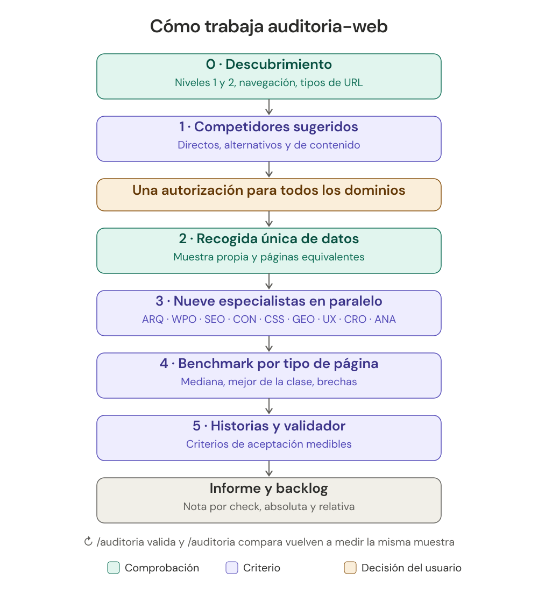
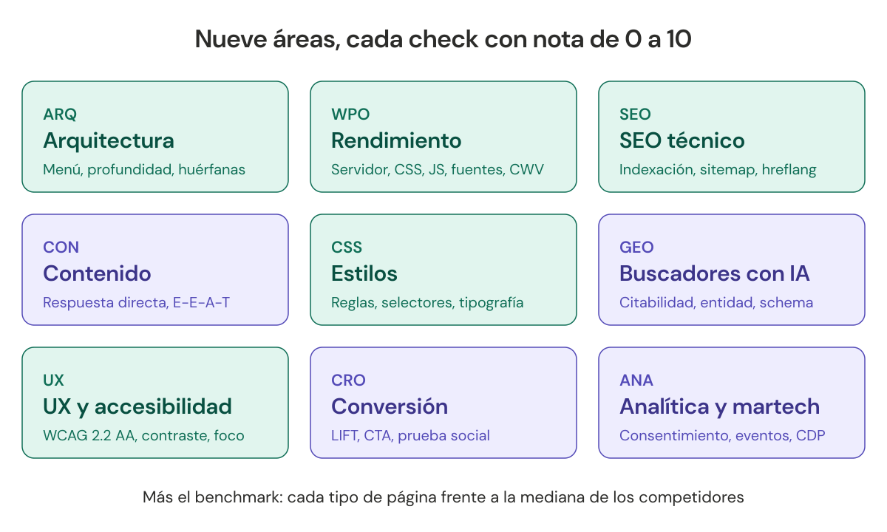
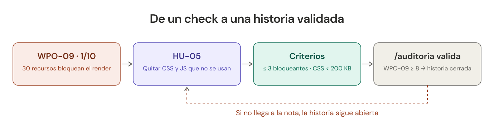

# auditoria-web

**Auditoría web completa con subagentes para Claude**: descubrimiento, arquitectura, rendimiento (WPO), SEO técnico, contenido, estilos, GEO, UX y accesibilidad, CRO y analítica. Compara cada tipo de página con los competidores y convierte los hallazgos en **historias de usuario con criterios de aceptación** que se validan volviendo a medir.

[English version](README.en.md) · [Post explicativo](https://makethejump.org/es/tendencias/auditoria-web-skill-subagentes/) · Autor: [Javier Ortiz](https://makethejump.org) · Licencia MIT



## Qué la hace distinta

- **Primero entiende la web, después la mide.** Rastrea el primer y el segundo nivel, extrae la navegación, detecta el tipo de negocio, categoriza las URLs y elige una muestra representativa. Nunca audita solo la home.
- **Todo tiene nota, también lo que está bien.** Cada check lleva ID, valor medido, objetivo y nota de 0 a 10. Sin valor medido no hay nota.
- **Benchmark por tipo de página.** Propone competidores directos, alternativos y de contenido, pide **una sola autorización** para abrirlos todos y compara cada tipo de página con la mediana y con el mejor de la clase.
- **Termina en un backlog, no en un PDF.** Cada nota baja se convierte en una historia de usuario con criterios medibles, lista para Jira, Linear o GitHub Issues.
- **Segura por diseño.** No usa hooks ni telemetría, no guarda claves y no cambia nada en la web: solo lee.





## Instalación

### Claude Code (recomendado: mide de verdad con Playwright)

```bash
/plugin marketplace add javierortizsaiz-dot/makethejump
/plugin install auditoria-web@makethejump
```

Para que el recolector mida rendimiento, accesibilidad y CSS con un navegador real:

```bash
npm install
npx playwright install chromium
```

### claude.ai

Descarga [`dist/auditoria-web-skill.zip`](dist/auditoria-web-skill.zip) y súbelo en **Ajustes → Capacidades → Skills**. En claude.ai funciona en modo básico: usa los subagentes de la sesión y mide con el navegador o con fetch.

## Uso

| Comando | Qué hace |
| --- | --- |
| `/auditoria <url>` | Auditoría completa: descubrimiento, competidores, 9 áreas, benchmark e historias |
| `/auditoria <area> <url>` | Una sola área: descubrimiento, arquitectura, wpo, seo, contenido, estilos, geo, ux, cro, analitica o benchmark |
| `/auditoria baseline <url>` | Guarda la nota de cada check para comparar después |
| `/auditoria compara <url>` | Vuelve a medir la misma muestra y muestra qué ha cambiado |
| `/auditoria valida HU-05 <url>` | Vuelve a medir solo los checks de una historia y dice si se cumplen sus criterios |

## Cómo está hecha

| Fase | Subagente | Modelo | Herramientas |
| --- | --- | --- | --- |
| 0 · Descubrimiento | `descubridor` | Sonnet | WebFetch, Bash, Read, Write |
| 1 · Competidores | `analista-mercado` | Opus | WebSearch, WebFetch |
| 2 · Recogida | `recolector` (usa `scripts/recoger.mjs`) | Sonnet | Bash, WebFetch |
| 3 · Especialistas | `arquitectura`, `wpo`, `seo-tecnico`, `estilos`, `ux-accesibilidad` | Sonnet | Solo lectura de los datos |
| 3 · Especialistas | `contenido`, `geo`, `cro`, `analitica-martech` | Opus | Solo lectura de los datos |
| 4 · Benchmark | `benchmark` | Opus | Solo lectura |
| 5 · Historias | `product-owner` | Opus | Solo lectura y escritura del informe |
| 5 · Validación | `validador` | Sonnet | Solo lectura |

Los datos se recogen **una sola vez** y los especialistas trabajan sobre ellos, sin repetir peticiones. Los modelos con más criterio (Opus) se reservan para lo que necesita juicio; los rápidos (Sonnet), para medir y comprobar.

Salida en la carpeta `auditoria/` del proyecto:

```
auditoria/
  descubrimiento.json · descubrimiento.md
  competidores.json
  datos/<dominio>/<pagina>.json
  areas/<area>.json · <area>.md
  benchmark.json · benchmark.md
  historias.json · historias.md
  informe.md
```

## Ejemplo de historia de usuario

> **HU-05 · Quitar CSS y JS que no se usan**
> Como candidato con móvil y mala cobertura, quiero que la página pese poco, para ver el mensaje sin esperar.
>
> - [ ] La home carga ≤ 5 hojas de estilo y ≤ 3 recursos que bloquean el render.
> - [ ] CSS total < 200 KB descomprimido y JS < 250 KB.
> - [ ] Lighthouse móvil: rendimiento ≥ 85, LCP < 2,5 s.
>
> Validación: WPO-09 ≥ 8 y CSS-03 ≥ 6.

## Seguridad

Lee [SECURITY.md](SECURITY.md). En resumen: no hay hooks, no hay telemetría, no se guardan claves, el rastreo es moderado (1 petición por segundo, nivel 2 como máximo) y el texto de las webs auditadas se trata como dato, nunca como instrucciones.

## Licencia

MIT. Úsala, adáptala y cuéntame qué tal.
